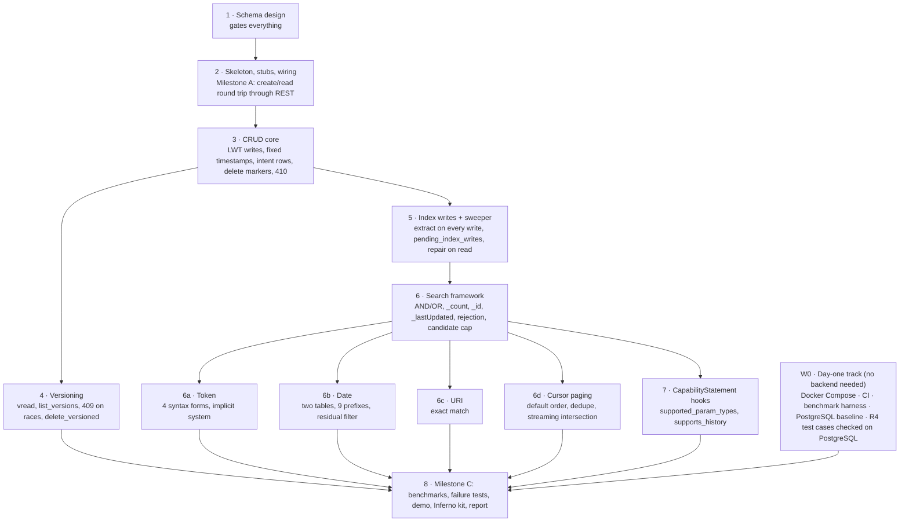

# Development Roadmap: Cassandra Backend for Helios

Alan Cruz, Anastasia Bryzgalova, Diya Subhashbhai Patel, Sara Lahourpour, Samuel Michaels Rodriguez · Draft, October 2026

This roadmap turns the design in `cassandra-discussion.md` into ordered work with exit criteria. The design document owns the *what* and the *why*; this one owns the *in what order*, *by whom*, and *how we know a step is done*. Where the two disagree, the design document wins and this file is updated. Baseline revision: `a5e74a3604b181722a2d02b11f29cc76e91520bd`.

## 1. Ground rules

- **Every step has an exit criterion that a script or a test can check.** "Done" means the criterion passes on CI, not that the code exists.
- **The trait hierarchy sets the order.** `VersionedStorage` and `SearchProvider` both extend `ResourceStorage`, so CRUD lands before vread or search. Every table depends on the schema, so the schema is designed and signed off before any backend code.
- **Nothing is R4-specific.** No `FhirVersion::R4` literal outside tests; defaults come from `FhirVersion::default_enabled()` and the backend config. CI compiles the crate in an R4B-only build from the first skeleton onward.
- **One owner per shared file.** `backends/mod.rs`, `lib.rs`, the persistence, rest and hfs `Cargo.toml` files, `crates/rest/src/config.rs` and `crates/hfs/src/main.rs` are edited by one person. Everyone else works in `crates/persistence/src/backends/cassandra/` and in their own file there.
- **Measure before optimizing.** The partition-bucketing and tombstone decisions in the design are measure-first. Nobody adds a bucket until a trigger in section 7 fires.
- **Upstream-shaped from day one.** Commits are small, the CapabilityStatement patch is kept separable, and no change outside `backends/cassandra/` is made without a line in section 8's "upstream touch list".
- **Track upstream weekly.** The baseline hash is pinned for the report, but the code is not frozen: upstream changed 103 files under `persistence` and `rest` between the baseline and today. Every week one person merges `upstream/main` into `main` on a `sync/upstream-YYYY-MM-DD` branch (the naming already used in this fork) and CI must pass on it before it merges. A scheduled CI job does a dry-run merge nightly and opens an issue if the build breaks, so a new required trait method is found the day it lands, not the day of a demo.
- **Heavy checks run on CI, not on laptops.** The workspace compiles all FHIR models; `cargo clippy --all-targets --all-features` is a CI-only job, run with the exact flags in `CONTRIBUTING.md`. Locally, developers run `cargo check -p helios-persistence --features cassandra` and the Cassandra test binary; `cargo fmt --all` is cheap and runs everywhere. Pull requests merge only when the CI clippy job is green.
- **Machines.** Two Apple-silicon laptops with 16 GB, two with 18 GB, one Apple-silicon machine with 32 GB that also runs the CI workflow, and one Windows machine with 32 GB. Single-node Cassandra runs everywhere with `MAX_HEAP_SIZE=1G` on the 16 and 18 GB machines and `2G` on the 32 GB machines; the three-node cluster (three JVMs) runs only on the two 32 GB machines. Benchmarks that go in the report run on one designated 32 GB machine so numbers are comparable. The Windows machine follows the worktree and `nul` notes in `CLAUDE.md` and uses Docker Desktop with WSL 2 for the containers.

## 2. Workstreams and dependencies

Five workstreams. The first three are strictly ordered; the last two start on day one and merge at the end.

**Parallelism.** Steps 1 and 2 are whole-team or single-owner. From step 3 onward two people can work (CRUD core and the day-one track). From step 6 onward four people work at once on 6a to 6d and 7, each in its own file. Step 8 needs everything.

## 3. Milestones

| Milestone | What passes | Gate |
| --- | --- | --- |
| **A. Round trip** | `HFS_STORAGE_BACKEND=cassandra` starts Helios against a local Cassandra; `POST /Patient` then `GET /Patient/{id}` returns the resource with `meta.versionId = "1"` and `ETag: W/"1"`. | Step 2 |
| **B. Correct** | CRUD, versioning, the three search types, cursor paging and rejection pass the shared suites listed in section 5 on a single node; the failure tests in section 6 pass; the R4B compile check passes. | Steps 3 to 7 |
| **C. Measured and shown** | Benchmarks run on both backends with raw results committed; the scripted demonstration passes every step on Cassandra and on PostgreSQL; the report is drafted. | Step 8 |

### Progress matrix

One row per checkable item, grouped by step; the milestone column says which gate it feeds. Update the row in the same commit that completes the item, and put the pull request or commit in the evidence column. Status: ☐ not started · ◐ in progress · ✅ done. Owner codes are the ones used in section 4 (**W** wiring owner, **A** to **E** as suggested there).

| # | Item | Milestone | Owner | Status | Date | Evidence |
| --- | --- | --- | --- | --- | --- | --- |
| 0.1 | Single-node Compose file: Cassandra 5.0.x pinned, `paxos_variant: v2`, explicit heap, CPU/memory limits recorded | A | E | ☐ | | |
| 0.2 | PostgreSQL Compose file with the same limits, `synchronous_commit` recorded | A | E | ☐ | | |
| 0.3 | Three-node Compose cluster: RF 3, `GossipingPropertyFileSnitch`, DC name matching the keyspace | B | E | ☐ | | |
| 0.4 | CI: `cargo check -p helios-persistence --no-default-features --features cassandra,R4B` | A | E | ☐ | | |
| 0.5 | CI: fmt check, the `CONTRIBUTING.md` clippy job with `-D warnings`, `rust-cache`, and the Cassandra test job against the single-node container | B | E | ☐ | | |
| 0.6 | Benchmark harness: open-loop load, warm-up, three runs, CSV output, 409 separated from 5xx | C | E | ☐ | | |
| 0.7 | Synthea datasets (fixed seed, Patient and Observation) for 10,000 and 100,000 resources; version, seed, modules and checksums recorded; generation script committed | C | E | ☐ | | |
| 0.8 | PostgreSQL baseline CSVs for both dataset sizes | C | E | ☐ | | |
| 0.9 | Demonstration script written and passing against PostgreSQL | C | E | ☐ | | |
| 0.10 | Cassandra spike done and write-up in `docs/Cassandra/`, read before the schema session | A | A | ☐ | | |
| 0.11 | Upstream canary workflow scheduled and has run once; weekly `sync/upstream-*` merge in place | A | E | ☐ | | |
| 1.1 | `schema.cql` applies cleanly to a fresh node; every checklist item in Step 1 decided and recorded | A | W | ☐ | | |
| 1.2 | Paper walk-through of every in-scope operation and the sweeper path | A | all | ☐ | | |
| 1.3 | Query coverage table in the repo | A | all | ☐ | | |
| 1.4 | Every member's sign-off on `schema.cql` recorded in their ADR log | A | all | ☐ | | |
| 2.0 | Cassandra `GenericImage` test container in `tests/common/` with CQL readiness wait and cleanup hook | A | A | ☐ | | |
| 2.1 | `backends/cassandra/` skeleton compiles; stubs for the 12 bound traits; listed defaults overridden | A | A | ☐ | | |
| 2.2 | `cassandra` feature threaded through rest and hfs; `StorageBackendMode::Cassandra`; `start_cassandra`; `patient_name_search_support` arm; feature fallback | A | W | ☐ | | |
| 2.3 | `TenantSearchRegistries` plumbing and `search_param_registry` | A | A | ☐ | | |
| 2.4 | Cassandra module in `backend_capability_contract.rs`; stale table in `tests/common/capabilities.rs` fixed or removed | A | A | ☐ | | |
| 2.5 | `TestableBackend` implemented for Cassandra against the Compose single node | A | A | ☐ | | |
| 2.6 | Conformance-seeder boot time measured and recorded | A | A | ☐ | | |
| 2.7 | **Milestone A** script passes: create then read through REST, `versionId` 1, `ETag W/"1"`; `/_readiness` down when Cassandra is stopped | A | W | ☐ | | |
| 3.1 | Six-step write path: intent row, CAS with `write_ts`/`write_id`, versions row, index batches, intent delete | B | A | ☐ | | |
| 3.2 | CAS outcome mapping (404/409/410 from condition columns) and timeout handling (`CAS`, `CAS_WRITE_UNKNOWN`, `SIMPLE`, serial-read timeout) | B | A | ☐ | | |
| 3.3 | `crud_suite.rs` and `search/versioned_write_race_suite.rs` pass | B | A | ☐ | | |
| 3.4 | 410 after delete, 200 after revive; no CQL `DELETE` ever issued against `resources` | B | A | ☐ | | |
| 4.1 | `VersionedStorage` real; `versioning_suite.rs` and `search/conditional_if_match_suite.rs` pass; `list_versions` numeric order past 9 | B | A | ☐ | | |
| 5.1 | Index maintenance on every write with fixed timestamps; every batch under 5 KiB on the fixtures | B | A | ☐ | | |
| 5.2 | Sweeper: 32 partitions polled, grace period, `write_id` comparison, previous keys from `resource_versions`, intent deleted | B | B | ☐ | | |
| 5.3 | Repair-on-read hook | B | B | ☐ | | |
| 5.4 | Index-versus-fresh-extraction consistency utility passes after any write sequence | B | B | ☐ | | |
| 6.1 | Search framework entry validation and every documented rejection with its status code | B | B | ☐ | | |
| 6.2 | `_id`, `_lastUpdated`, unfiltered type search, `search_count`, `_count=0` | B | B | ☐ | | |
| 6.3 | Streaming AND/OR, dedupe on `(last_updated, id)`, candidate cap with `too-costly`, `next_cursor` always minted | B | B | ☐ | | |
| 6.4 | `search/meta_params_suite.rs`, `empty_value_suite.rs`, `large_id_set_suite.rs` pass | B | B | ☐ | | |
| 6a | Token: four forms, implicit system merge, case-sensitive, pipe rule; `token_code_system_suite.rs` passes | B | C | ☐ | | |
| 6b | Date: both tables, nine prefixes, residual filter; `date_boundary`, `date_period`, `date_precision`, `ap_prefix`, `ap_relations` suites pass; parity with PostgreSQL on the fixtures | B | D | ☐ | | |
| 6c | URI: exact match; coverage-table cases pass; trailing-slash variant does not match | B | C | ☐ | | |
| 6d | Cursor paging: default order, reserved bucket slot, `InvalidCursor`; 100,000 resources paged with no duplicates or gaps | B | D | ☐ | | |
| 6.5 | Multitenancy suites pass (`tenant_id_fidelity`, `tenant_existence`, `multitenancy_suite`) | B | B | ☐ | | |
| 7.1 | `supported_param_types` and `supports_history` hooks; handler filters parameters and omits history; existing capabilities tests green for all backends | B | W | ☐ | | |
| 7.2 | `GET /metadata` on Cassandra lists only token, date and URI parameters and no history interactions | B | W | ☐ | | |
| 7.3 | Handler patch opened upstream as its own pull request | C | W | ☐ | | |
| 8.1 | Failure tests in section 6 pass on the single node | B | E | ☐ | | |
| 8.2 | **Milestone B**: all items 2.1 to 8.1 done and CI green | B | W | ☐ | | |
| 8.3 | Failure tests pass on the three-node cluster | C | E | ☐ | | |
| 8.4 | Benchmarks on both backends: raw CSVs, environment record, `nodetool` histograms, tombstones per read | C | E | ☐ | | |
| 8.5 | Measure-first triggers in section 7 evaluated and the outcome recorded | C | E | ☐ | | |
| 8.6 | Demonstration script passes on Cassandra and on PostgreSQL in CI | C | all | ☐ | | |
| 8.7 | Inferno test kit (`utils/inferno-test-kit/`): capability-truth, CRUD and versioning, supported-search and declared-rejection groups; every test passes against Cassandra, in the UI and headless in CI | C | C | ☐ | | |
| 8.8 | The same kit against PostgreSQL: capability-truth, CRUD and supported-search groups pass; the rejection group fails as expected and the contrast is recorded for the report | C | C | ☐ | | |
| 8.9 | One-off US Core v3.1.1 server-suite run against Cassandra, headless, pinned kit version; results JSON kept; every failure mapped to a declared rejection or a CapabilityStatement line | C | A | ☐ | | |
| 8.10 | README Cassandra column and the upstream touch list updated | C | W | ☐ | | |
| 8.11 | Report draft reviewed by all five | C | all | ☐ | | |
| 8.12 | **Milestone C**: all items done; artifacts in section 11 committed with the commit hash | C | all | ☐ | | |

## 4. Steps in detail

Each step lists goal, tasks, exit criterion, and who. "Who" is a suggested split for five people and can be reshuffled; the owner of shared files (called **W** below) does not change mid-project.

Each step also lists **Spec**: the FHIR pages to have open while implementing it. R4 is normative for this project; a build link appears only where the design document's "What the FHIR specification requires" table says the build differs, and that table remains the one-page summary of the rules. Links were checked on 2026-10-13.

### Step 0 · Day-one track (runs throughout)

**Goal.** Everything that needs no Cassandra code exists before the backend does, so Milestone C is not blocked on tooling.

**Tasks.**
- Cassandra spike, before the schema session: one day, one person, on the single-node Compose file. In `cqlsh`: create a two-table toy schema, run one `INSERT … IF NOT EXISTS` and one conditional `UPDATE`, run one logged batch deliberately over `batch_size_warn_threshold` and read the warning, run `TRACING ON` for a clustering slice and a full-partition scan, delete a few hundred rows and read `nodetool tablestats` to see tombstones, and kill the container mid-batch to watch batchlog replay. Exit: a two-page write-up in `docs/Cassandra/` with the traces, which the schema session reads first.
- Docker Compose for Cassandra 5.0.x (pinned tag) with `paxos_variant: v2`, explicit `MAX_HEAP_SIZE`, `batch_size_warn_threshold`/`fail_threshold` left at defaults, and CPU/memory limits recorded in the file. A second Compose file for a three-node cluster on one host (RF 3, `GossipingPropertyFileSnitch`, one DC name matching the keyspace's `NetworkTopologyStrategy` map). A PostgreSQL Compose file with the same resource limits and its `synchronous_commit` setting recorded.
- CI on the GitHub-hosted workflow: `cargo fmt --all -- --check`; `cargo check -p helios-persistence --no-default-features --features cassandra,R4B` (verified passing on the baseline today); the `CONTRIBUTING.md` clippy command with `-D warnings` as its own job; and a job that starts the single-node Cassandra container and runs the Cassandra test binary. Use `Swatinem/rust-cache` so the FHIR model crates are not rebuilt on every push.
- Upstream canary: a scheduled workflow (nightly) that fetches `upstream/main`, merges it into a throwaway branch, runs `cargo check` on the workspace with the `cassandra` feature, and opens or updates a single issue titled "upstream drift" when the merge conflicts or the check fails. The weekly `sync/upstream-YYYY-MM-DD` branch is then routine instead of a surprise.
- Benchmark harness: an open-loop HTTP load generator with a fixed request schedule (not a closed loop, which understates p95), warm-up, three measured runs, and output of throughput, median and p95 latency, error rates (409 counted separately from 5xx) and run-to-run variation as CSV. Benchmark datasets of 10,000 and 100,000 resources produced by Synthea with a fixed seed and population size, filtered to Patient and Observation, with the Synthea version, seed, module list and output checksums recorded in the repo; the generation script is the reproducible artifact, and the generated bundles are published as a release asset rather than committed.
- PostgreSQL baseline numbers collected with the harness, so the Cassandra numbers have something to stand next to from the first run.
- R4 test cases: the request/response pairs the demonstration will replay, written and checked against PostgreSQL first, so a later failure on Cassandra is a Cassandra bug and not a test bug.

**Spec.** The demo request/response pairs follow [R4 RESTful API](https://hl7.org/fhir/R4/http.html) and [R4 Search](https://hl7.org/fhir/R4/search.html), with JSON per [R4 JSON representation](https://hl7.org/fhir/R4/json.html). Synthea emits transaction bundles ([R4 Bundle: batch/transaction](https://hl7.org/fhir/R4/bundle.html#transaction)); Cassandra does not advertise `transaction`, so the loader must rewrite them to batch as `crates/hfs/tests/inferno/to_batch.jq` already does for S3, and the benchmark create path should POST single resources, which is what the proposal measures. The harness's error accounting separates the statuses defined in [R4 http.html#concurrency](https://hl7.org/fhir/R4/http.html#concurrency) (409, 412) from 5xx.

**Exit criterion.** The spike write-up is in the repo; CI is green on an empty `backends/cassandra/` module and the upstream canary has run once; the Synthea datasets regenerate to the recorded checksums; the harness produces the PostgreSQL baseline CSV for both dataset sizes; the demo script passes on PostgreSQL.

**Who.** One person (**E**), full time until step 6, then joins failure testing.

### Step 1 · Schema design

**Goal.** Agree the ten tables, keys, types and the write path before anyone types CQL.

**Tasks.**
- Write `schema.cql` for `resources`, `resource_versions`, `pending_index_writes`, `resources_by_type`, `token_code_index`, `token_system_code_index`, `token_system_index`, `date_index`, `date_index_by_end`, `uri_index`. The design document fixes the keys and clustering; the checklist below is what the design leaves implicit and `schema.cql` must state.

**Checklist for `schema.cql`.**

| Item | Decision to record |
| --- | --- |
| Keyspace | `CREATE KEYSPACE … WITH replication = {'class': 'NetworkTopologyStrategy', '<dc>': 1}` locally and `3` on the cluster; the DC name must match the Compose files' `GossipingPropertyFileSnitch` setting |
| Common types | `tenant_id text`, `resource_type text`, `id text` (never `uuid`), `version_id int`, `last_updated timestamp` (milliseconds), `fhir_version text` (`as_mime_param()` form), `write_ts bigint` (microseconds, used in `USING TIMESTAMP`), `write_id uuid` |
| `resources` regular columns | `data` (choose `text` holding the JSON, or `blob` if compression measurements favour it; `text` is the default), `created_at timestamp`, `deleted_at timestamp` (unset, never bound null), `fhir_version`, `write_ts`, `write_id` |
| `resource_versions` regular columns | `data` (unset for a delete marker), `last_updated`, `deleted_at`, `fhir_version`, `write_ts` |
| `resources_by_type` | clustering `WITH CLUSTERING ORDER BY (last_updated DESC, id DESC)`; regular `version_id` |
| Token tables | `token_code_index` clustering `(last_updated DESC, id DESC, system ASC)`; `token_system_code_index` `(last_updated DESC, id DESC)`; `token_system_index` `(last_updated DESC, id DESC, code ASC)`; `param text` in every partition key; regular `version_id` |
| Date tables | `date_index` clustering `(start ASC, id ASC, end ASC)`; `date_index_by_end` clustering `(end ASC, id ASC, start ASC)`; `start`/`end timestamp`, finite because the shared `indexed_range` maps an open Period end to its `open_end` sentinel; regular `version_id` |
| `uri_index` | `uri text` in the partition key; clustering `(last_updated DESC, id DESC)`; regular `version_id` |
| `pending_index_writes` | partition `(bucket text, shard smallint)`, `bucket` = UTC hour as `YYYY-MM-DDTHH`, `shard` = `hash(tenant_id, id) mod 16`; clustering `(tenant_id, enqueued_at timeuuid, resource_type, id)`; regular `write_id uuid`; `default_time_to_live = 86400` |
| Index-table options | lower `gc_grace_seconds` on the six index tables and `resources_by_type` only (the tag check makes resurrected rows harmless); never on `resources` or `resource_versions` |
| Compaction | pick per table and record why: the index tables are read-heavy and tombstone-heavy, `resources` is point-read, `pending_index_writes` is TTL-churn; the 5.0 default (`UnifiedCompactionStrategy` in `cassandra_latest.yaml`) is the starting point, with the choice confirmed by the tombstone numbers in section 7 |
| Statements that must never exist | a CQL `DELETE` against `resources`; any bind of `null`; any `ALLOW FILTERING` |
- Walk every in-scope operation through the tables on paper: create, read, update, delete, revive, vread, list_versions, each token form, each date prefix, URI, `_id`, `_lastUpdated`, unfiltered type search, `count`, cursor page, and the sweeper's path.
- Decide the cursor encoding, including the reserved third `sort_values` slot for a future bucket.
- Produce the query coverage table promised in the proposal: capability × parameter type × prefix or form × expected result.

**Spec.** Column types come from the resource rules: [R4 resource.html#id](https://hl7.org/fhir/R4/resource.html#id) (ids are `[A-Za-z0-9\-\.]{1,64}` and case-sensitive, hence `id text`, never `uuid`), [R4 resource.html#metadata](https://hl7.org/fhir/R4/resource.html#metadata) (`versionId`, `lastUpdated`), and [R4 datatypes.html#instant](https://hl7.org/fhir/R4/datatypes.html#instant) (`lastUpdated` is an instant, so `timestamp` with milliseconds). The index tables encode [R4 search.html#token](https://hl7.org/fhir/R4/search.html#token) (system and code columns, the four forms), [R4 search.html#date](https://hl7.org/fhir/R4/search.html#date) (every value is a range, so `start` and `end`; partial dates widen to their period; see [datatypes.html#dateTime](https://hl7.org/fhir/R4/datatypes.html#dateTime), [#Period](https://hl7.org/fhir/R4/datatypes.html#Period), [#Timing](https://hl7.org/fhir/R4/datatypes.html#Timing)) and [R4 search.html#uri](https://hl7.org/fhir/R4/search.html#uri) (whole-URI, case-sensitive, so `uri text` in the partition key). `fhir_version` holds the value of [R4 http.html#version-parameter](https://hl7.org/fhir/R4/http.html#version-parameter) (`fhirVersion` MIME parameter, see also [versions.html](https://hl7.org/fhir/R4/versions.html)). The coverage table's rows are the parameters of [Patient](https://hl7.org/fhir/R4/patient.html#search) and [Observation](https://hl7.org/fhir/R4/observation.html#search) whose type is token, date or uri, plus `_id` and `_lastUpdated` from [R4 search.html#all](https://hl7.org/fhir/R4/search.html#all). Multi-tenancy has no FHIR rule; it is a Helios concept (`tenant_id` first in every key).

**Exit criterion.** `schema.cql` applies cleanly to a fresh Cassandra 5.0 node; the coverage table is in the repo; every team member can explain the write path from memory.

**Who.** **W** leads the two design sessions; every member reviews `schema.cql` and records their sign-off, and any objection, in their own ADR log under `docs/Cassandra/`.

### Step 2 · Skeleton, stubs and wiring → Milestone A

**Goal.** The server compiles with the Cassandra backend, starts against Cassandra, and does one create/read round trip through REST.

**Tasks.**
- `crates/persistence/src/backends/cassandra/{mod.rs, backend.rs, storage.rs, config.rs, schema.rs, errors.rs}`; uncomment `pub mod cassandra` in `backends/mod.rs`.
- Implement `Backend` (`type Connection`, `kind() = BackendKind::Cassandra`, `health_check`, `initialize` applies `schema.cql`, `migrate`), connection setup with `cdrs-tokio` 8 (explicit `LOCAL_QUORUM`/`LOCAL_SERIAL` on every statement, prepared statements cached).
- Implement `ResourceStorage::create` and `read` only; stub every other required method of the 12 bound traits with `UnsupportedCapability { backend_name: "cassandra" }` (or `TransactionError::AtomicityUnsupported` for `BundleProvider`). Override the defaults the design lists: `readiness_check`, `is_cluster_shared`, `bulk_write_concurrency`, `supports_conditional`.
- Wiring (owner **W**): `cassandra` feature threaded through `crates/rest/Cargo.toml` and `crates/hfs/Cargo.toml` like `mongodb`; `StorageBackendMode::Cassandra` with `Display`, `FromStr`, `primary_backend_kind`; `start_cassandra` in `main.rs` modelled on `start_s3` (passing `None` wherever S3 does); the `patient_name_search_support` arm (`IdOnly`); the `#[cfg(not(feature = "cassandra"))]` fallback.
- `TenantSearchRegistries` plumbing and `search_param_registry`, because capabilities and batch call it even before search exists.
- Cassandra test container. The persistence tests use `testcontainers` with `testcontainers-modules` features for postgres, elastic_search, minio and mongo; there is no cassandra module, so add a `GenericImage` for the pinned Cassandra 5.0 tag in `tests/common/` with a readiness wait on the CQL port (9042) that also retries a trivial `SELECT` until the JVM accepts connections, `MAX_HEAP_SIZE` set small for tests, and the same `#[ctor::dtor]` cleanup hook the other containers use. Budget a day: Cassandra's startup is slower than the other stores and the first attempts usually time out.
- Add a Cassandra module to `tests/backend_capability_contract.rs` with the golden capability list (`Crud`, `Versioning`, `OptimisticLocking`, `BasicSearch`, `DateSearch`, `CursorPagination`, `SharedSchema`), and remove or fix the stale Cassandra table in `tests/common/capabilities.rs`.
- Confirm the conformance seeder runs at boot (about 1,400 LWT creates per tenant) and record boot time; if it is unacceptable, this is where `create_many` gets a concurrent implementation.

**Spec.** The two interactions in Milestone A are [R4 http.html#create](https://hl7.org/fhir/R4/http.html#create) (server assigns `id`, `versionId`, `lastUpdated`; 201 with `Location` and `ETag`) and [R4 http.html#read](https://hl7.org/fhir/R4/http.html#read) (200, 404, 410). The `BundleProvider` stub refuses [R4 http.html#transaction](https://hl7.org/fhir/R4/http.html#transaction) bundles; batch keeps working through the REST layer because [R4 bundle.html#transaction](https://hl7.org/fhir/R4/bundle.html#transaction) lets each entry fail independently. The seeder at boot writes [SearchParameter](https://hl7.org/fhir/R4/searchparameter.html) and [CompartmentDefinition](https://hl7.org/fhir/R4/compartmentdefinition.html) resources from the R4 registry ([searchparameter-registry.html](https://hl7.org/fhir/R4/searchparameter-registry.html), shipped as `data/search-parameters-r4.json`), which is why `search_param_registry` must exist before search does. Readiness and health endpoints are not FHIR; the CapabilityStatement at [R4 http.html#capabilities](https://hl7.org/fhir/R4/http.html#capabilities) is, and must respond as soon as the server is up.

**Exit criterion.** Milestone A passes by script; the capability contract test passes; the R4B compile check passes; `/_readiness` reports down when Cassandra is stopped.

**Who.** **W** on wiring, one person (**A**) on the backend skeleton.

### Step 3 · CRUD core

**Goal.** Every write to `resources` is a compare-and-swap with a fixed per-version timestamp and an intent row; deletes are soft; reads return 410 after delete.

**Tasks.**
- `update`, `delete`, `create_or_update`, `delete_versioned`, `exists`, `count`, `read_batch` (concurrent point reads).
- The six-step write path from the design: permission check and extraction; intent row; CAS with `write_ts(N+1) = max(now_µs, write_ts(N)+1)` and `write_id`; `resource_versions` row `USING TIMESTAMP`; index batches under 5 KiB (empty until step 5); intent delete and return.
- CAS outcome handling: not-applied rows mapped to 404/409/410 from the returned condition columns; `WriteTimeout` with `write_type = CAS` or `CAS_WRITE_UNKNOWN` resolved by a `LOCAL_SERIAL` read and `write_id` match; `SIMPLE` treated as applied; serial-read timeout → 503.
- Revive via `create_or_update` with `IF version_id = N` and no `deleted_at` condition; `create` via `INSERT … IF NOT EXISTS`.
- `tenant.check_permission` at the start of every write.

**Spec.** [R4 http.html#create](https://hl7.org/fhir/R4/http.html#create), [#update](https://hl7.org/fhir/R4/http.html#update) (client `id` must match the URL; update of a deleted resource brings it back; a server may reject an update that creates), [#delete](https://hl7.org/fhir/R4/http.html#delete) (delete of an unknown or already-deleted id returns 200 or 204 and changes nothing; a later read is 410 Gone; servers keeping history record the delete as an entry with no content) and [#concurrency](https://hl7.org/fhir/R4/http.html#concurrency) (`ETag: W/"vid"`; `If-Match` mismatch is 412 and nothing changes; 409 is permitted for other conflicts, which is where Helios puts the lost CAS race). `meta.versionId` and `meta.lastUpdated` rules are in [R4 resource.html#metadata](https://hl7.org/fhir/R4/resource.html#metadata). Error bodies are [OperationOutcome](https://hl7.org/fhir/R4/operationoutcome.html) with codes from [issue-type](https://hl7.org/fhir/R4/valueset-issue-type.html) (`not-found`, `deleted`, `conflict`). The build weakens the 410 wording and the ETag-on-update requirement ([build http.html#update](https://build.fhir.org/http.html#update), [#delete](https://build.fhir.org/http.html#delete)); we follow R4.

**Exit criterion.** `crud_suite.rs` passes; `search/versioned_write_race_suite.rs` passes (two concurrent updates produce N+1 and N+2, never two N+1); a read after delete is 410 and after revive is 200; `cqlsh` shows no CQL `DELETE` was ever issued against `resources`.

**Who.** **A**, with **W** reviewing the CAS code.

### Step 4 · Versioning

**Goal.** `VersionedStorage` is real.

**Tasks.** `vread`, `list_versions`, `current_version`, `update_with_match` and `delete_with_match` (same CAS, returning `VersionConflict`), delete markers as version rows with no content, `version_id int` ordering verified past 9.

**Spec.** [R4 http.html#vread](https://hl7.org/fhir/R4/http.html#vread) (`GET [type]/[id]/_history/[vid]`; a deleted version should return 410; `versionId` is opaque to clients but we keep it a counter) and [R4 http.html#history](https://hl7.org/fhir/R4/http.html#history) for the shape of a delete marker, which we store even though the history interactions themselves are not offered (see step 7). `update_with_match` and `delete_with_match` implement [R4 http.html#concurrency](https://hl7.org/fhir/R4/http.html#concurrency) at the storage layer. `versioning: versioned` is defined in [versioning-policy](https://hl7.org/fhir/R4/valueset-versioning-policy.html).

**Exit criterion.** `versioning_suite.rs` and `search/conditional_if_match_suite.rs` pass; vread of a deleted version returns 410; `list_versions` returns 12 versions in numeric order.

**Who.** **A**.

### Step 5 · Index writes and the sweeper

**Goal.** Every create, update and delete maintains the six index tables and `resources_by_type`, and a crash between the CAS and the index writes is healed automatically.

**Tasks.**
- `SearchParameterExtractor::extract` on every write; diff old and new key sets; deletes and upserts `USING TIMESTAMP write_ts`; batches grouped under the warn threshold and sent concurrently; `BATCH` vs `BATCH_LOG` timeout handling.
- `pending_index_writes` sweeper as a backend-owned background task: poll interval and grace period from config; the 16 shards of the current and previous hour bucket; `LOCAL_SERIAL` read of the resource row; `write_id` comparison decides whether the CAS applied; re-run steps 4 and 5 for that version using the previous version's keys from `resource_versions`; delete the intent row. No clock comparison anywhere in the sweeper.
- Repair on read hook (used by step 6): given a mismatched tag, re-run index maintenance inline and delete the stale key.
- Measure and record batch sizes per fixture resource; assert the largest fixture stays under 5 KiB per batch.

**Spec.** What gets extracted is defined by each SearchParameter's `expression` ([R4 SearchParameter](https://hl7.org/fhir/R4/searchparameter.html), evaluated with [FHIRPath](https://hl7.org/fhir/R4/fhirpath.html)); the shared extractor already does this and we only store its output. Which elements feed a token, date or uri key is listed per type in [R4 search.html#token](https://hl7.org/fhir/R4/search.html#token), [#date](https://hl7.org/fhir/R4/search.html#date) and [#uri](https://hl7.org/fhir/R4/search.html#uri), and per resource in [Patient](https://hl7.org/fhir/R4/patient.html#search) and [Observation](https://hl7.org/fhir/R4/observation.html#search). The requirement the sweeper exists to meet is [R4 search.html#currency](https://hl7.org/fhir/R4/search.html#currency): search results must reflect the current state of the resources, so a committed write that is missing from an index table is a correctness bug, not a performance one.

**Exit criterion.** After any sequence of writes on the fixtures, a full scan of each index table matches a fresh extraction of every live resource (a test utility does this comparison); the crash-window tests in section 6 pass; batch size assertion passes.

**Who.** **A** on the write path, **B** on the sweeper.

### Step 6 · Search framework

**Goal.** `search()` and `search_count()` exist, enforce the rules, and dispatch to per-type modules.

**Tasks.**
- Entry validation in order: `validate_date_values`, `validate_value_presence`, `reject_unsupported_metadata_modifier`; refuse parameter types other than token, date, URI (400); refuse any modifier (400); refuse `_include`/`_revinclude` when `query.includes` is non-empty (501); refuse `_text`/`_content` (501); refuse `_offset` and non-default `_sort` (400).
- `_id` as a point read on `resources`; `_lastUpdated` as a slice on `resources_by_type`; unfiltered type search on `resources_by_type`.
- AND across parameters by streaming intersection in `(last_updated DESC, id DESC)` order with clustering point reads; OR within a parameter by merging partitions; dedupe on `(last_updated, id)`; stop at `_count + 1` distinct resources that pass the tag check.
- Date predicates as residual filters when combined with any other parameter.
- Configurable candidate cap returning an OperationOutcome with `too-costly`.
- `search_count` and `_count=0` behaving as `_summary=count`.
- Always mint `next_cursor` when a next page exists.

**Spec.** Rejections: [R4 search.html#modifiers](https://hl7.org/fhir/R4/search.html#modifiers) (a server SHALL reject an unsupported modifier, 400 with an OperationOutcome; also [build #modifiers](https://build.fhir.org/search.html#modifiers), which adds `:text-advanced`, `:code-text`, `:iterate`), [R4 search.html#errors](https://hl7.org/fhir/R4/search.html#errors) (unknown or unsupported parameters SHOULD be ignored unless `Prefer: handling=strict`; refusing parameter types is our stricter choice and must be documented in the CapabilityStatement), and the features we refuse: [#sort](https://hl7.org/fhir/R4/search.html#sort), [#include](https://hl7.org/fhir/R4/search.html#include), [#revinclude](https://hl7.org/fhir/R4/search.html#revinclude), [#chaining](https://hl7.org/fhir/R4/search.html#chaining), [#has](https://hl7.org/fhir/R4/search.html#has), [#text](https://hl7.org/fhir/R4/search.html#text), [#content](https://hl7.org/fhir/R4/search.html#content). OperationOutcome codes `not-supported` and `too-costly` are in [issue-type](https://hl7.org/fhir/R4/valueset-issue-type.html). Semantics we implement: [R4 search.html#combining](https://hl7.org/fhir/R4/search.html#combining) (AND across parameters and repeats, OR across comma lists, a modifier applies to every OR value), [#all](https://hl7.org/fhir/R4/search.html#all) (`_id`, `_lastUpdated`), [#count](https://hl7.org/fhir/R4/search.html#count) (never more than `_count`; `_count=0` behaves as `_summary=count`), [#summary](https://hl7.org/fhir/R4/search.html#summary) and [#total](https://hl7.org/fhir/R4/search.html#total). Search parameter types are enumerated in [R4 search.html#ptypes](https://hl7.org/fhir/R4/search.html#ptypes) and [search-param-type](https://hl7.org/fhir/R4/valueset-search-param-type.html).

**Exit criterion.** `search/meta_params_suite.rs` (for `_id` and `_lastUpdated`) and `search/empty_value_suite.rs` pass; a test asserts each rejection above returns the documented status; a search with no parameters pages through 1,000 fixtures with no duplicates and no gaps.

**Who.** **B**.

### Steps 6a to 6d · Search types and paging (parallel, one file each)

| Step | File | Scope | Exit criterion | Who |
| --- | --- | --- | --- | --- |
| 6a Token | `search/token.rs` | `code`, `system\|code`, `\|code`, `system\|`; `''` sentinel; `IMPLICIT_TOKEN_SYSTEM` two-partition merge; case-sensitive matching; pipe forms rejected on ContactPoint, uri and boolean elements | `search/token_code_system_suite.rs` passes; a token search for a code present under two systems returns each resource once | **C** |
| 6b Date | `search/date.rs` | `date_index` and `date_index_by_end`; slice choice per prefix per the design; `RangePredicate::matches` on every row; Rust-side sort and cursor cut; candidate cap | `search/date_boundary_suite.rs`, `date_period_suite.rs`, `date_precision_suite.rs`, `ap_prefix_suite.rs`, `ap_relations_suite.rs` pass; every prefix verified against PostgreSQL on the same fixtures | **D** |
| 6c URI | `search/uri.rs` | exact, case- and accent-sensitive whole-URI match on `uri_index` | the URI cases from the coverage table pass; a trailing-slash variant does not match | **C** |
| 6d Cursor | `search/paging.rs` | `PageCursor` with millisecond RFC 3339 and reserved bucket slot; `(last_updated, id) < (?, ?)` slices; `InvalidCursor` on malformed input; no `previous` on page one, no `next` after the last | `search/pagination_tests.rs` adapted to the backend passes; paging through all 100,000 benchmark resources yields exactly 100,000 distinct ids | **D** |

**Spec for 6a to 6d.**
- **6a Token:** [R4 search.html#token](https://hl7.org/fhir/R4/search.html#token) (four forms; literal, case-sensitive matching; `_id` always case-sensitive; no pipe form on ContactPoint, uri or boolean elements), [#escaping](https://hl7.org/fhir/R4/search.html#escaping) (`\|` and `\,` inside values), and the source datatypes [Coding](https://hl7.org/fhir/R4/datatypes.html#Coding), [CodeableConcept](https://hl7.org/fhir/R4/datatypes.html#CodeableConcept), [Identifier](https://hl7.org/fhir/R4/datatypes.html#Identifier), [ContactPoint](https://hl7.org/fhir/R4/datatypes.html#ContactPoint), [code](https://hl7.org/fhir/R4/datatypes.html#code), [boolean](https://hl7.org/fhir/R4/datatypes.html#boolean). The build adds `id` to the token table ([build #token](https://build.fhir.org/search.html#token)).
- **6b Date:** [R4 search.html#date](https://hl7.org/fhir/R4/search.html#date) and [#prefix](https://hl7.org/fhir/R4/search.html#prefix) (the nine prefixes defined by range overlap, `eq` default, `ap` approximate), with [date](https://hl7.org/fhir/R4/datatypes.html#date), [dateTime](https://hl7.org/fhir/R4/datatypes.html#dateTime), [instant](https://hl7.org/fhir/R4/datatypes.html#instant), [Period](https://hl7.org/fhir/R4/datatypes.html#Period) and [Timing](https://hl7.org/fhir/R4/datatypes.html#Timing) for how each element becomes a range. The build restates the prefixes as boundary tests ([build #date](https://build.fhir.org/search.html#date)); the shared `range_predicate` encodes R4 and the PostgreSQL parity check is the tie-breaker.
- **6c URI:** [R4 search.html#uri](https://hl7.org/fhir/R4/search.html#uri) (exact whole-URI match, case- and accent-sensitive; `:above` and `:below` are modifiers we reject), with [uri](https://hl7.org/fhir/R4/datatypes.html#uri) and [canonical](https://hl7.org/fhir/R4/datatypes.html#canonical) as sources. The build drops "escape" from the sensitivity list ([build #uri](https://build.fhir.org/search.html#uri)).
- **6d Cursor:** [R4 http.html#paging](https://hl7.org/fhir/R4/http.html#paging) (opaque links, `self` required, never more than `_count`) and [build #paging](https://build.fhir.org/http.html#paging) (no `previous` on page one, no `next` after the last page, which we follow), the searchset Bundle shape in [R4 bundle.html#searchset](https://hl7.org/fhir/R4/bundle.html#searchset), and [R4 search.html#currency](https://hl7.org/fhir/R4/search.html#currency) for what may change while a client pages. Neither version defines keyset or offset paging; the cursor format is ours.

### Step 7 · CapabilityStatement hooks (separable upstream patch)

**Goal.** The CapabilityStatement advertises only what the backend supports.

**Tasks.**
- `SearchProvider::supported_param_types()` defaulted to all types; Cassandra returns token, date, URI. `build_search_params` filters by it; `build_resource_capability` drops `_include`/`_revinclude` when the backend has no include support.
- `InstanceHistoryProvider::supports_history()` defaulted to `true`; Cassandra returns `false`. The handler omits `history-instance`, `history-type`, `history-system` and sets `readHistory: false`; `vread` and `versioning: versioned` stay. `build_capability_statement` adds `InstanceHistoryProvider` to its own bound.
- Tests: `crates/rest/tests/capabilities_search_params.rs` and `rest_conformance.rs` gain a stub backend overriding both hooks; existing default-path tests stay green.
- Kept on its own branch and submitted upstream as its own pull request.

**Spec.** [R4 http.html#capabilities](https://hl7.org/fhir/R4/http.html#capabilities) (`GET [base]/metadata` SHALL return a CapabilityStatement describing what the server actually supports) and [R4 CapabilityStatement](https://hl7.org/fhir/R4/capabilitystatement.html), in particular [rest.resource.searchParam](https://hl7.org/fhir/R4/capabilitystatement-definitions.html#CapabilityStatement.rest.resource.searchParam) (only the parameters we serve, typed per [search-param-type](https://hl7.org/fhir/R4/valueset-search-param-type.html)), [rest.resource.interaction](https://hl7.org/fhir/R4/capabilitystatement-definitions.html#CapabilityStatement.rest.resource.interaction) and [rest.interaction](https://hl7.org/fhir/R4/capabilitystatement-definitions.html#CapabilityStatement.rest.interaction) (codes from [type-restful-interaction](https://hl7.org/fhir/R4/valueset-type-restful-interaction.html) and [system-restful-interaction](https://hl7.org/fhir/R4/valueset-system-restful-interaction.html): keep `vread`, drop `history-instance`, `history-type`, `history-system`, `transaction`), [rest.resource.readHistory](https://hl7.org/fhir/R4/capabilitystatement-definitions.html#CapabilityStatement.rest.resource.readHistory) (`false`) and [rest.resource.versioning](https://hl7.org/fhir/R4/capabilitystatement-definitions.html#CapabilityStatement.rest.resource.versioning) (`versioned`, from [versioning-policy](https://hl7.org/fhir/R4/valueset-versioning-policy.html)). [R4 search.html#errors](https://hl7.org/fhir/R4/search.html#errors) is the reason the statement must be truthful: clients are told to consult it before relying on a parameter.

**Exit criterion.** `GET /metadata` on Cassandra lists only token, date and URI parameters per resource and no history interactions; all existing capabilities tests pass for SQLite, PostgreSQL, MongoDB, Elasticsearch and S3.

**Who.** **W**, after step 6 lands.

### Step 8 · Benchmarks, failure tests, demonstration, report → Milestone C

**Goal.** The proposal's objectives 4 and 5 are delivered with reproducible artifacts.

**Tasks.**
- Benchmarks per the proposal: 10,000 and 100,000 resources; create, read-by-ID, update, token, date and URI searches; concurrency 1, 8, 32; warm-up then three runs; single node (RF 1, `LOCAL_QUORUM` = `ONE`) against single PostgreSQL under the same limits. Before each run: load, `nodetool flush`, wait for pending compactions to reach zero, JIT warm-up. Reset data between runs. Record `paxos_variant`, commit-log and fsync settings, JVM heap, image tags, dataset checksums. Collect `nodetool proxyhistograms` and `tablestats` to split Helios time from database time. Record tombstones scanned per read and batch sizes.
- Failure tests from section 6, on the single node and on the three-node Compose cluster.
- Demonstration script: one HTTP session covering create, read, vread, update with an `If-Match` conflict, a batch bundle, token, date and URI searches with cursor paging, a rejected `:exact`, deletion with 410, two-tenant isolation; the same script against PostgreSQL; passes when every step returns the documented status.
- Inferno test kit, built from `inferno-template` in `utils/inferno-test-kit/` (a Ruby gem outside the cargo workspace). Four groups, each test written from the rejection table in the design document and citing the spec sentence it enforces: (1) capability truth: `GET /metadata` lists only token, date and URI parameters, no string or reference parameters, no `_include` or `_revinclude`, no `transaction` interaction, no history; (2) CRUD and versioning: create, read, update, vread, `If-Match` mismatch 412, delete then read 410; (3) supported search: `_id`, identifier with and without system, date prefixes and `_lastUpdated`, URI, and keyset paging that follows `next` links and asserts no duplicate or missing ids; (4) declared rejections: string and reference parameters 400, `:exact` 400, `_sort` and `_offset` 400, chain and `_has` 400, `_include` and `_text` 501, transaction bundle refused, each with an OperationOutcome and a cross-check that the parameter is absent from the CapabilityStatement. The kit calls no profile validation, so the validator service is removed from its Compose file and it runs on the 16 GB laptops. A GitHub-hosted workflow runs it headless with `inferno execute` and uploads the results JSON. Run it against PostgreSQL once: groups 1 to 3 must pass there too, which validates the kit; group 4 fails there by design and the diff goes in the report.
- One-off US Core v3.1.1 run. The inherited `inferno-us-core.yml`, `install.sh` and fixtures are reused with a `cassandra` matrix leg and a pinned test-kit version, run once headless on a GitHub-hosted runner or a 32 GB machine. The results JSON is kept and every failure is mapped to a declared rejection or to a CapabilityStatement line. This is a documented negative result, not a gate: US Core searches by `patient` reference and by name and adds `_revinclude=Provenance:target`, none of which a standalone Cassandra primary supports.
- Report and README updates: the persistence README's Cassandra column (○ → ✓ for every in-scope row, `:exact` → ✗ with a note, the "no backend" note removed), the other places that say Cassandra is absent, and the upstream touch list in section 8. The four Multitenancy rows currently show — (backend not present) and become: **Shared Schema ✓** (`tenant_id` leads every partition key, the one isolation model every backend implements, and it also goes in the Tenant Isolation table as "`tenant_id` first in every partition key"); **Schema-per-Tenant ✗** (a keyspace per tenant is possible but not planned, like every other column); **Database-per-Tenant ✗** (not planned; only S3's bucket-per-tenant is real, and the README says not to read ○ as a deployable guarantee); **Row-Level Security ✗** (a PostgreSQL feature with no Cassandra equivalent). The column therefore reads ✓ ✗ ✗ ✗, the same shape as SQLite.

**Spec.** The demo script and the Inferno kit assert statuses from [R4 RESTful API](https://hl7.org/fhir/R4/http.html): [#create](https://hl7.org/fhir/R4/http.html#create) 201, [#read](https://hl7.org/fhir/R4/http.html#read) 200/404/410, [#update](https://hl7.org/fhir/R4/http.html#update) 200, [#concurrency](https://hl7.org/fhir/R4/http.html#concurrency) 412, [#delete](https://hl7.org/fhir/R4/http.html#delete) then 410, [#transaction](https://hl7.org/fhir/R4/http.html#transaction) for the batch response (200 with a status per entry) and the refused transaction, [#paging](https://hl7.org/fhir/R4/http.html#paging) for the `next` links; and from [R4 Search](https://hl7.org/fhir/R4/search.html): [#modifiers](https://hl7.org/fhir/R4/search.html#modifiers) (`:exact` 400), [#errors](https://hl7.org/fhir/R4/search.html#errors) and [#combining](https://hl7.org/fhir/R4/search.html#combining). Every error body is an [OperationOutcome](https://hl7.org/fhir/R4/operationoutcome.html). The capability-truth group reads the statement per [R4 http.html#capabilities](https://hl7.org/fhir/R4/http.html#capabilities). The US Core leg is judged against the [US Core 3.1.1 server CapabilityStatement](https://hl7.org/fhir/us/core/STU3.1.1/CapabilityStatement-us-core-server.html), which is what makes its `patient`, `name` and `_revinclude` requirements explicit, and the kit itself is documented at [Inferno Core](https://inferno-framework.github.io/docs/) and the [US Core Test Kit](https://github.com/inferno-framework/us-core-test-kit). Benchmarks and failure tests have no FHIR rule beyond returning the statuses above under load and after recovery.

**Exit criterion.** Raw CSVs for every configuration committed with the commit hash and environment record; failure-test log committed; demo script passes on both backends in CI; the Inferno kit passes on Cassandra in CI and its PostgreSQL contrast and the US Core mapping are committed; report draft reviewed by all five.

**Who.** **E** leads benchmarks and failure tests; **C** writes the Inferno kit after 6a and 6c land; **A** runs the US Core leg on the inherited workflow; everyone contributes to the demo and report.

## 5. Test gates by step

The shared suites live under `crates/persistence/tests/` and are `#[path]`-included into each backend's test binary (see `tests/mongodb_tests.rs` for the pattern, about 60 includes). `tests/cassandra_tests.rs` includes only what is in scope; the table says why each excluded suite is excluded so nobody re-litigates it.

| Suite | Step | In scope? |
| --- | --- | --- |
| `crud_suite.rs` | 3 | Yes |
| `versioning_suite.rs` | 4 | Yes |
| `search/versioned_write_race_suite.rs` | 3 | Yes, the CAS contract |
| `search/conditional_if_match_suite.rs` | 4 | Yes, If-Match through REST |
| `search/token_code_system_suite.rs` | 6a | Yes |
| `search/date_boundary_suite.rs`, `date_period_suite.rs`, `date_precision_suite.rs`, `ap_prefix_suite.rs`, `ap_relations_suite.rs` | 6b | Yes |
| `search/date_minute_index_suite.rs` | 6b | Check: applies if the suite assumes minute-resolution storage; we store milliseconds |
| `search/meta_params_suite.rs` | 6 | Yes for `_id` and `_lastUpdated`; the `_tag`/`_profile`/`_security` cases are token searches and should also pass |
| `search/empty_value_suite.rs` | 6 | Yes |
| `search/pagination_tests.rs` | 6d | Yes, cursor cases only; offset cases must be skipped via the harness capability flags |
| `search/large_id_set_suite.rs` | 6 | Yes, exercises `_id` lists and `read_batch` |
| `multitenancy/tenant_id_fidelity_suite.rs`, `tenant_existence_suite.rs`, `multitenancy_suite.rs` | 3 | Yes |
| `transactions/if_match_suite.rs` | 4 | Yes if it uses single-resource PUT; transaction-bundle cases are out |
| `search/modifier_parity_suite.rs`, `sort_*`, `string_tests.rs`, `number_*`, `quantity_tests.rs`, `reference_tests.rs`, `chained_tests.rs`, `include_tests.rs`, `contained_suite.rs`, `composite_*`, `fts_*` | — | No: unsupported parameter types, modifiers, sort, chaining, include, contained, composite, full text |
| `transactions_suite.rs`, `transactions/bundle_*`, `rollback_tests.rs`, `conditional_*` | — | No: transactions and conditional operations are ✗ |
| `search_suite.rs` | 6 | Partially: include it and gate the unsupported sections with the harness's capability flags; if that is not possible, copy the in-scope tests into `tests/cassandra/` |

The harness (`tests/common/harness.rs`: `TestableBackend`, `TestContext`, `TestContextBuilder`) is how a backend declares what it supports to the suites. Step 2 implements `TestableBackend` for Cassandra against the Compose single node.

## 6. Failure tests

All run against the single node first, then the three-node cluster (RF 3, `LOCAL_QUORUM`).

| Test | Kill or fault point | Expected |
| --- | --- | --- |
| Intent then crash | Helios killed after step 2 (intent row) and before step 3 (CAS) | After the grace period the sweeper deletes the intent row; `read` is unchanged; no index rows change |
| CAS then crash | Helios killed after step 3 and before step 5 | `read` and `vread` return N+1 immediately; search hides the resource until the sweeper runs (bounded by poll interval + grace), then returns it; `count` is correct after the sweep |
| Batch partially applied | Coordinator node killed mid-batch on the cluster | Batchlog replay completes the batch; tag check hides nothing wrong meanwhile |
| Concurrent updates | 32 clients updating the same resource | Exactly one writer per version; every other gets 409; final index state equals a fresh extraction |
| Stale batch ordering | Writer of N+1 paused after its CAS until N+2 completes, then resumed | N+1's late writes are ignored (older `write_ts`); search returns N+2 content; no orphan rows |
| Node down, RF 3 | One of three nodes stopped | Reads and writes continue at `LOCAL_QUORUM`; LWTs continue; restart and repair; no data loss |
| Partition, RF 3 | Coordinator isolated from the other two | Writes fail with `Unavailable` (503) rather than silently; heal; reconciliation verified |
| Restart | Cassandra restarted | Every resource and version survives; search unchanged |
| Tombstone pressure | 10 minutes of update load on one resource type, then `count` and a date scan | Tombstones scanned per read recorded; no `TombstoneOverwhelmingException`; numbers feed section 7 |

## 7. Measure-first triggers

These decide whether the time-bucket and tombstone work in the design is done in this project. If a trigger fires, the bucket is added to the affected partition key, carried in the reserved cursor slot, and walked newest first; otherwise the design stays as is and the measurement goes in the report.

| Signal | Trigger | Action |
| --- | --- | --- |
| Tombstones scanned per read (`tablestats`, read histograms) | above 1,000 on any search or `count` in the benchmark | bucket the affected table; lower `gc_grace_seconds` on index tables |
| `count` or `end`-side date scan latency | above the p95 budget agreed for the benchmark | bucket `resources_by_type` or the date tables |
| Largest partition (`tablestats`) | above 100 MiB | bucket, regardless of latency |
| Batch size per write | any fixture above 5 KiB per batch | split batches further; never raise the threshold |
| Boot time from the conformance seeder | above the agreed startup budget | concurrent `create_many` |

## 8. Upstream touch list

Everything outside `crates/persistence/src/backends/cassandra/` that this project changes, so the final pull requests are easy to review and the course report can separate our contribution from the baseline.

- `crates/persistence/Cargo.toml` (feature already exists; dependencies unchanged), `crates/rest/Cargo.toml`, `crates/hfs/Cargo.toml`: thread the `cassandra` feature.
- `crates/persistence/src/backends/mod.rs`, `src/lib.rs`, `src/composite/mod.rs`: remove "no Cassandra backend" statements; export the module.
- `crates/rest/src/config.rs`: `StorageBackendMode::Cassandra`.
- `crates/hfs/src/main.rs`: `start_cassandra`, the `patient_name_search_support` arm, feature fallback.
- `crates/persistence/README.md`: Cassandra column, placement table, backend list, tenancy notes, transaction note.
- `ROADMAP.md`, `book/src/appendix-d-changelog.md`: status.
- `crates/persistence/tests/backend_capability_contract.rs`: Cassandra module; `tests/common/capabilities.rs`: stale table fixed or removed; `tests/cassandra_tests.rs`: new binary.
- Separate PR: `crates/rest/src/handlers/capabilities.rs`, `core/search.rs` (`supported_param_types`), `core/history.rs` (`supports_history`), and the two capabilities test files.
- CI workflow: R4B compile check and the Cassandra test job.
- `utils/inferno-test-kit/`: new, outside the cargo workspace; `.github/disabled-workflows/inferno-us-core.yml`: a `cassandra` matrix leg for the one-off run.

## 9. Schedule: six weeks, 13 October to 22 November 2026

| Week | Dates | Steps | Milestone |
| --- | --- | --- | --- |
| 1 | 13 to 18 Oct | 0: spike (day 1), Compose files, CI skeleton, upstream canary; 1: both schema sessions, `schema.cql` signed off, coverage table; 2 starts (skeleton, wiring) | |
| 2 | 19 to 25 Oct | 2 finishes; 3 (CRUD core); 0: harness, Synthea datasets, PostgreSQL baseline, demo script passing on PostgreSQL | **A** round trip by Wed 21 Oct |
| 3 | 26 Oct to 1 Nov | 4 (versioning), 5 (index writes, sweeper); 6 (search framework) starts mid-week | |
| 4 | 2 to 8 Nov | 6a, 6b, 6c, 6d in parallel; 7 (hooks); single-node failure tests | **B** correct by Sun 8 Nov |
| 5 | 9 to 15 Nov | 8: benchmarks on both backends, cluster failure tests, Inferno kit, US Core one-off run | |
| 6 | 16 to 22 Nov | 8: demo on both backends, README and upstream pull requests, report, slides, recorded presentation | **C** measured and shown by Sun 22 Nov |

## 10. Risks and what we do about them

| Risk | Early signal | Mitigation |
| --- | --- | --- |
| Date search is the largest piece and slips | 6b not green by Thursday 5 November | 6b owner gets 6c's owner once URI is done (early week 4); residual-filter path is simpler and lands first; `date_index_by_end` is the last part |
| LWT cost makes the benchmark one-sided | Create p95 far above PostgreSQL in the first run | Expected; the report explains it. Confirm `paxos_variant: v2` is in effect, and that the intent row and version row are not in the same batch as index writes |
| Batch size limit tripped by real resources | Step 5 batch-size assertion fails on a fixture | Split batches further; never raise the server threshold |
| Sweeper and request race | Duplicate index writes in logs | Harmless by design (fixed timestamps); verify in the concurrent-update failure test |
| cdrs-tokio blocking bug | A driver issue with no workaround in two days | Switch to `scylla` behind the same internal `Session` trait; the design already documents the protocol v4 consequence |
| Boot time from seeding | Milestone A startup above budget | Concurrent `create_many` in step 2 |
| Shared-file merge conflicts | Two PRs touch `main.rs` | Only **W** edits shared files; others open issues against **W** |
| Upstream review latency on the capabilities patch | No response before the report is due | The patch is separable; the project deliverable does not depend on it being merged |
| Three-node cluster flakiness in CI | Intermittent failures | Cluster tests run on demand and locally; CI gates on the single node only |

## 11. Definition of done for the deliverables

- **Source code:** `backends/cassandra/` plus the upstream touch list, on a branch whose every commit builds; the R4B compile check green.
- **Schema and setup scripts:** `schema.cql`, both Compose files, a `make` or script entry point that starts a database, applies the schema, seeds fixtures and runs the tests.
- **Datasets:** the Synthea generation script with its pinned version, seed and module list, the checksums of the 10,000 and 100,000 sets, and the generated bundles as a release asset.
- **Automated tests:** `tests/cassandra_tests.rs` with the suites in section 5; the failure tests in section 6 as scripts with expected outputs.
- **Benchmarks:** harness source, raw CSVs per configuration, the environment record, and the notebook or script that produces the report's tables.
- **Demonstration:** the HTTP session script and its recorded output on both backends.
- **Conformance:** the Inferno test kit source with its `setup.sh` and `run.sh`, the pinned Inferno Core version, its results JSON on Cassandra and on PostgreSQL, and the US Core v3.1.1 results JSON with the failure-to-rejection mapping.
- **Documentation:** the design document and this roadmap kept current; the README changes; the report.
